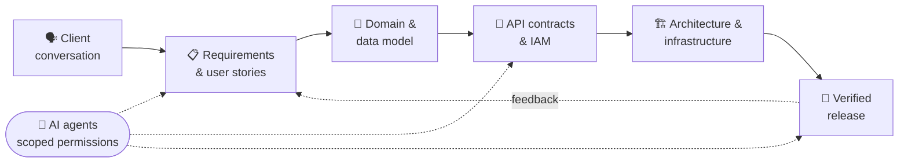

<!-- ===================================================== -->
<!-- ================  RECRUITER SUMMARY  ================ -->
<!-- ===================================================== -->

<h1 align="center">Stifh Barragan</h1>

<p align="center">
  <b>Software Architect & Engineer</b> · Solutions Architecture and AI-First Systems<br>
  <sub>6+ years taking systems from the first client conversation to production</sub>
</p>

<p align="center">
  <a href="./stifh-barragan-software-architect-cv.pdf"></a>
</p>

<p align="center">
  <a href="https://stifhbl.com" target="_blank"></a>
  <a href="https://linkedin.com/in/stifhbl" target="_blank"></a>
  <a href="mailto:stifhlife@gmail.com"></a>
</p>

---

## 👨‍💻 About Me

I design and build systems that scale. With **6+ years** in software development, my focus has shifted from writing code to **architecting solutions**: requirements interpretation, domain and data modeling, API contract design, and the architecture and infrastructure decisions behind them. Currently **Software Architect at VencejosLab**, with AI agents as part of the toolchain.

- 🏗️ Migrating legacy systems (.NET Framework, PHP, Java 8) to modern, layered architectures
- 🏢 Architecting **multi-tenant** platforms with versioned API contracts and IAM design
- ⚡ Designing **event-driven** async processing: queues, workers, idempotency, race conditions
- 📐 Designing database models and API specifications
- 🔄 Orchestrating CI/CD pipelines that improve team velocity
- 📝 Researching distributed systems (Physarum-inspired routing & CRDTs) and LoRA / PEFT

---

## 💼 Experience

| Role | Company | Period |
|------|---------|--------|
| **Software Architect** | VencejosLab · Corrientes, AR (Hybrid) | Feb 2026 – Present |
| **Software Engineer** | VencejosLab · Corrientes, AR (Hybrid) | Jul 2025 – Feb 2026 |
| **Independent Consultant · Software Engineer** | Remote | Jun 2021 – Jul 2025 |
| **Software Developer** | Textknow · Bogotá, CO | May 2018 – Aug 2020 |

---

## 🎯 Core Competencies

<p align="center">
  
  
  
</p>
<p align="center">
  
  
  
</p>
<p align="center">
  
  
  
</p>

---

## 🛠️ Tech Stack

| | |
|---|---|
| **Languages** |  |
| **Backend** |  |
| **Frontend** |  |
| **Data & Cloud** |  |
| **DevOps & Tools** |  |
| **Also** |       |

---

## 🚀 Featured Projects

<table align="center">
  <tr>
    <td width="33%" align="center">
      <a href="https://github.com/S4WLAND/E-commerce-Microservices-Platform-Project" target="_blank">
        
        <br><strong>E-commerce Microservices</strong>
      </a>
      <br>
      <sub>Spring Boot 3 · K8s · RabbitMQ</sub>
      <br>
      <sub>🏗️ Event-driven microservices</sub>
    </td>
    <td width="33%" align="center">
      <a href="https://pypi.org/project/big-O-test-library" target="_blank">
        
        <br><strong>big-O-test-library</strong>
      </a>
      <br>
      <sub>PyPI Package · Algorithm Analysis</sub>
      <br>
      <sub>📈 Compare complexity instantly</sub>
    </td>
    <td width="33%" align="center">
      <a href="https://github.com/S4WLAND/QA-Automation-Framework-project" target="_blank">
        
        <br><strong>QA Automation Framework</strong>
      </a>
      <br>
      <sub>Playwright · Jest · CI/CD</sub>
      <br>
      <sub>🧪 E2E testing infrastructure</sub>
    </td>
  </tr>
</table>

---

## 🎓 Education & Certifications

**🎓 B.Eng. Computer and Systems Engineering**  
Universidad Nacional de Colombia · 2020 – In progress

**📜 Professional Certifications**
- 🏛️ **University of Alberta** — Software Design and Architecture Specialization
- 🔵 **IBM** — Applied DevOps Engineering Professional Certificate
- ☕ **IBM** — Java Developer Professional Certificate

<br>

<!-- ===================================================== -->
<!-- ===============  HOW I BUILD (CREATIVE)  ============ -->
<!-- ===================================================== -->

<p align="center">
  
</p>

## 🧭 How I Build



```typescript
const stifh = {
  role: "Software Architect & Engineer",
  company: "VencejosLab",
  focus: ["System Design", "Distributed Systems", "Clean Architecture", "Multi-Tenant", "Event-Driven"],
  principle: "The simplest solution that carries the expected growth",
  currentResearch: ["Bio-inspired protocols for decentralized P2P networks", "LoRA / PEFT"],
  languages: ["JavaScript/TypeScript", "Python", "Java", "C#", "SQL"],
  spoken: ["Spanish (native)", "English (B2)"],
  typingSpeed: "114 WPM",
};
```

### 🤖 AI-First Development

<p align="center">
  
  
  
  
</p>

<details>
<summary><b>🧩 Agentic SDLC Framework (internal product)</b></summary>
<br>

CLI framework standardizing how client projects are started, tracked and delivered:

- 🧱 **Four separated layers** with clear responsibilities
- 🏷️ **State derived from typed commits** through CI
- 🧠 **Per-layer instructions** routing AI tools to the right context

</details>

### 📚 Current Research

<details>
<summary><b>🔬 Flow-Based Data Protocol: Bio-Inspired Distributed Systems</b></summary>
<br>

Developing a theoretical framework exploring how biological organisms like **Physarum polycephalum** (slime mold) can inform better approaches to distributed systems challenges:

- 🌐 **Unified routing, replication, and scheduling** through a single governing equation
- 🧬 **CRDTs** (Conflict-free Replicated Data Types) for eventual consistency
- 🔄 **Adaptive erasure coding** vs. massive duplication strategies
- 🕸️ **Self-organizing networks** without central coordination

> *"Tubes carrying high flow grow thicker; tubes with low flow atrophy and disappear."*

</details>

<details>
<summary><b>🧠 Parameter-Efficient Fine-Tuning of Foundation Models</b></summary>
<br>

Research on adapting foundation models with **LoRA / PEFT** techniques.

</details>

---

## 📊 GitHub Stats

<p align="center">
  <a href="https://github.com/S4WLAND" target="_blank">
    
  </a>
  <a href="https://github.com/S4WLAND" target="_blank">
    
  </a>
</p>

<p align="center">
  <a href="https://github.com/DenverCoder1/github-readme-streak-stats" target="_blank">
    
  </a>
</p>

<p align="center">
  <picture>
    <source media="(prefers-color-scheme: dark)" srcset="https://raw.githubusercontent.com/S4WLAND/S4WLAND/output/github-snake-dark.svg" />
    <source media="(prefers-color-scheme: light)" srcset="https://raw.githubusercontent.com/S4WLAND/S4WLAND/output/github-snake.svg" />
    
  </picture>
</p>

<p align="center">
  
</p>

<p align="center">
  <i>"The best code is clean and simple—and it's the same with systems architecture."</i>
</p>


